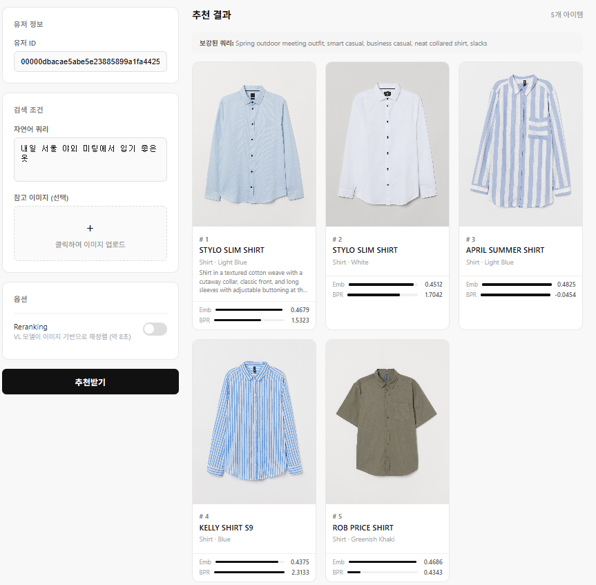
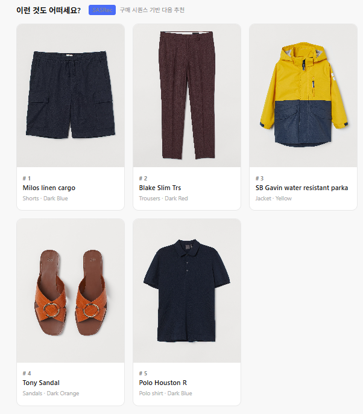
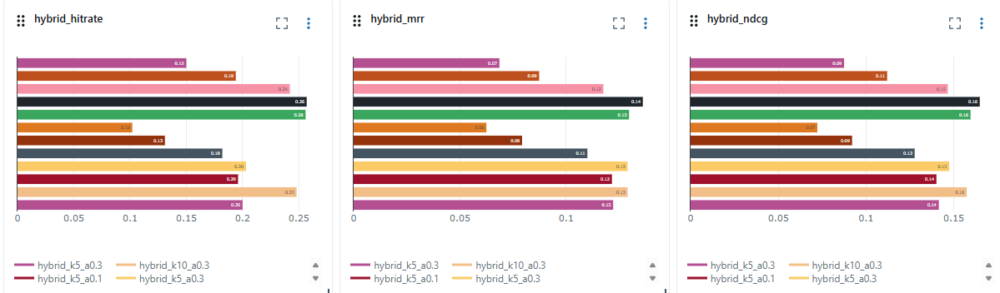

## Dataset
- H&M Personalized Fashion Recommendations (Kaggle)
- 105,542 items / 1,371,980 users / 31,788,324 transactions
- BPR 학습: 1,240,163 users / 91,798 items / 21,793,296 interactions (2018~2020 구매 데이터, 시간 기준 80% split)

## Tech Stack
- **Language**: Python, PyTorch
- **Embedding**: Qwen3-VL-Embedding-2B (multimodal, text + image)
- **Vector DB**: ChromaDB (105,542 items, 256×256)
- **Collaborative Filtering**: BPR (Bayesian Personalized Ranking), Two-Tower (+Qwen 콘텐츠 임베딩), SASRec (Sequential)
- **VL Reranker**: Qwen3-VL-Reranker-2B (local, 128×128 최적화) + article description 기반 추천 이유 제공
- **Query Agent**: LangChain + Gemini 2.5 Flash (날씨/트렌드/일정 툴 호출)

## Serving Latency
| 단계 | rerank 없음 | rerank 있음 |
|------|------------|------------|
| 쿼리 보강 (Gemini) | 5~7초 | 5~7초 |
| 쿼리 임베딩 | 0.5초 | 0.2초 |
| ChromaDB 검색 | 0.7초 | 0.1초 |
| BPR 스코어링 | 0.01초 | 0.01초 |
| reranker 추론 | - | 3.2초 |
| **전체** | **~8초** | **~11초** |

> Reranker 이미지 해상도 256×256 → 128×128 최적화로 추론 시간 16초 → 3.2초로 단축 (3.5배)  
> 쿼리 보강 Gemini API(5~7초) → Qwen3-VL-2B-Instruct 로컬 추론으로 대체 시 0.7초로 단축 가능.  
> VRAM 16GB 제약 (Embedding + Reranker 선점)으로 미적용. 추천 이유 생성은 LLM 생성 대신 article description으로 대체.

## Evaluation Results

### Hybrid vs Baseline (Leave-one-out, 1,000 users, 105,542 items)
| Model | HitRate@5 | HitRate@10 |
|-------|-----------|------------|
| BPR only | 0.005 | 0.010 |
| Embedding only | 0.079 | 0.121 |
| **Hybrid (alpha=0.3)** | **0.211** | **0.264** |

> Embedding only 대비 Hybrid: HitRate@5 기준 **+167%** 향상
> 평가 쿼리 : 정답 아이템의 product_type + graphical_appearance + colour_group
> ⚠️ 이 평가는 train 구매를 정답으로 써서 BPR이 정답을 학습 때 본 상태(leak). 미래 구매 기준 재평가는 [아래](#two-tower--재평가-미래-구매-기준) 참고.

### Embedding Ablation — CLIP vs Qwen3-VL (Leave-one-out, 1,000 users, 10,000 items)
| Model | HitRate@5 | HitRate@10 |
|-------|-----------|------------|
| CLIP (fashion-clip) | 0.331 | 0.426 |
| Qwen3-VL v1 (색깔 포함) | **0.489** | **0.600** |
| Qwen3-VL v2 (색깔 제외) | 0.388 | 0.477 |

> 텍스트 구성 ablation: 색깔 정보 포함 시 HitRate@5 기준 **+26%** 향상  
> Qwen3-VL이 CLIP 대비 HitRate@5 기준 **+48%** 우세

### Alpha Ablation — Hybrid Score (1,000 users 고정)

> HitRate@10에서는 alpha=0.1이 소폭 우세하나, NDCG와 MRR 전 구간에서 alpha=0.3이 최적.  
> 종합적으로 **alpha=0.3 (Emb 30% + BPR 70%)** 채택.

| alpha | HitRate@5 | HitRate@10 | NDCG@5 | NDCG@10 | MRR@5 | MRR@10 |
|-------|-----------|------------|--------|---------|-------|--------|
| 0.1 | 0.2020 | **0.2700** | 0.1362 | 0.1584 | 0.1144 | 0.1237 |
| **0.3** | **0.2160** | 0.2650 | **0.1470** | **0.1629** | **0.1243** | **0.1309** |
| 0.5 | 0.1810 | 0.2350 | 0.1215 | 0.1389 | 0.1020 | 0.1091 |
| 0.7 | 0.1230 | 0.1900 | 0.0811 | 0.1029 | 0.0674 | 0.0764 |
| 0.9 | 0.0900 | 0.1460 | 0.0585 | 0.0760 | 0.0482 | 0.0551 |

### SASRec — 시퀀스 기반 다음 구매 예측 (100 candidates, 1 positive + 99 negative)
| Model | HitRate@5 | NDCG@5 | MRR@5 | HitRate@10 | NDCG@10 | MRR@10 |
|-------|-----------|--------|-------|------------|---------|--------|
| SASRec | 0.0940 | 0.0705 | 0.0628 | 0.1090 | 0.0752 | 0.0647 |

> BPR/Embedding과 태스크가 달라 직접 비교 불가. SASRec은 시퀀스 기반 다음 구매 예측,  
> BPR/Embedding은 유저 취향 기반 추천으로 역할이 다름.  
> SASRec은 연관 추천("이런 것도 어떠세요?") 섹션에 별도 활용.
> 쿼리 맥락 반영을 위해 SASRec top50 후보에서 쿼리 임베딩 유사도로 재정렬하는 hybrid 구조 적용.
> ⚠️ 재검증 결과 `eval()` 추론 시 NaN 버그로 대부분 유저의 점수가 무효였음 → [SASRec 재검증](#sasrec-재검증-10000-users) 참고.

### Two-Tower + 재평가 (미래 구매 기준)

**요약**
- 현재 app 파이프라인 대비 **HitRate@10 +36%** (0.130 → 0.177): 가중치 튜닝 +16% → Two-Tower+Qwen 교체 +23% → 후보 확대 +36%
- Two-Tower+Qwen은 단독 개인화 추천에서 cornac BPR 대비 **Recall@12 +38%**, 이력 1~5개 유저 **+80%**, 신상품 추천 가능
- 성능 향상은 Two-Tower 구조가 아닌 **Qwen 콘텐츠 임베딩**에서 옴 (ID 기반 Two-Tower ≈ BPR)
- BM25·RRF·epsilon 탐색은 효과 없음, SASRec은 NaN 버그 발견

> 기존 평가는 train 구매 중 1개를 정답으로 써서 CF가 정답을 학습 때 이미 본 상태(**leak**).
> 새 평가(**future**)는 test 기간(시간 기준 뒤 20%)에 **새로 산 아이템**을 정답으로 사용 → CF가 못 본 미래 구매, 정답의 31%가 신상품.
> 조건: 아이템 인덱스는 Qwen3-VL-Embedding **텍스트 전용** 임베딩(105,542개). BPR은 app과 동일한 cornac BPR(k=64, 100 iter).

**모델**
- **Two-Tower**: 유저 타워(ID + 나이/멤버십) / 아이템 타워(ID + 카테고리 6종), in-batch softmax + logQ 보정
- **Two-Tower+Qwen**: 위에 아이템 타워 ← 상품 설명 Qwen 임베딩, 유저 타워 ← 최근 구매 20개 Qwen 임베딩 평균, ID dropout 30% (신상품은 ID 없이 콘텐츠로 임베딩)

#### CF 단독 비교 — test 기간 구매 예측 (10,000 users, @12)
| Model | Recall | HitRate | NDCG | 신상품 Recall |
|-------|--------|---------|------|---------------|
| Popularity (최근 1주) | 0.0092 | 0.0593 | 0.0070 | 0 |
| BPR (cornac, app) | 0.0117 | 0.0687 | 0.0104 | 0 |
| Two-Tower (ID + 카테고리) | 0.0131 | 0.0705 | 0.0112 | 0 |
| **Two-Tower+Qwen** | **0.0161** | **0.0831** | **0.0136** | **0.0021** |
| (참고) 최근 구매 재추천 | 0.0163 | 0.0777 | 0.0143 | 0 |

| 유저 이력 길이 (Recall@12) | 1-5 | 6-20 | 21+ |
|---|---|---|---|
| BPR (cornac, app) | 0.0087 | 0.0149 | 0.0106 |
| **Two-Tower+Qwen** | **0.0157** (+80%) | **0.0182** (+22%) | **0.0147** (+39%) |

> 쿼리 없이 유저 벡터 × 전체 아이템으로 test 기간 구매 예측 (홈 개인화 추천 상황).
> Two-Tower(ID+카테고리)는 BPR과 비슷한 수준 → 성능 향상은 구조가 아니라 **Qwen 콘텐츠 임베딩**에서 옴.
> Two-Tower+Qwen만 신상품 추천 가능. 서빙 비용은 BPR과 동일(64차원 내적, 후보 50개 0.003ms).

#### Hybrid — app 파이프라인 개선 (future, test 5,000 users, 가중치는 별도 tune 5,000 users에서 선택)
| 설정 | CF | 후보 | HitRate@10 | NDCG@10 | 현재 app 대비 |
|---|---|---|---|---|---|
| Embedding only | - | 쿼리 50 | 0.1044 | 0.0536 | |
| **현재 app (emb .5 / CF .3 / BM25 .2)** | BPR (cornac) | 쿼리 50 | 0.1304 | 0.0678 | 기준 |
| tuned (.4 / .6 / 0) | BPR (cornac) | 쿼리 50 | 0.1516 | 0.0803 | +16% |
| tuned (.3 / .7 / 0) | Two-Tower+Qwen | 쿼리 50 | 0.1598 | 0.0891 | +23% |
| tuned (.3 / .7 / 0) | Two-Tower+Qwen | 쿼리 50 ∪ Two-Tower 50 | 0.1692 | 0.0950 | +30% |
| **tuned (.4 / .6 / 0)** | **Two-Tower+Qwen** | **쿼리 1,000** | **0.1770** | **0.0977** | **+36%** |

> BM25는 grid search에서 모든 경우 가중치 0으로 선택 (향상 없음). RRF는 모든 경우 min-max보다 낮음. epsilon 탐색(0.1)은 정확도·다양성 모두 변화 미미.
> leak 프로토콜에서는 튜닝 가중치가 CF 0.8~0.9로 쏠림 → 정답 누수로 CF가 과대평가됨.

| 정답 종류 (HitRate@10, .3/.7/0) | BPR (cornac) | Two-Tower (ID) | Two-Tower+Qwen |
|---|---|---|---|
| 신상품 (1,510명) | 0.1040 | 0.0007 | **0.1702** |
| 기존 상품 (3,490명) | 0.1665 | **0.1799** | 0.1553 |

> Hybrid에서 Two-Tower+Qwen의 이득은 **신상품**에서 나옴. 기존 상품은 쿼리 임베딩과 정보가 겹쳐 ID 기반 CF가 더 보완적 → 상품 종류별 CF 앙상블 여지.

| 쿼리 후보 수 (Two-Tower+Qwen) | 50 | 100 | 200 | 500 | 1,000 |
|---|---|---|---|---|---|
| 후보 안에 정답 비율 | 28.5% | 40.4% | 53.1% | 70.3% | 82.8% |
| HitRate@10 | 0.1598 | 0.1686 | 0.1740 | 0.1766 | 0.1770 |

> 후보를 늘리면 정답 포함률은 크게 오르지만 최종 성능은 200개 이후 정체 → 가중합 재정렬의 한계, 학습 기반 랭커 여지.

#### SASRec 재검증 (10,000 users)
| Model | 기존 방식 (1+99, 학습 target) HitRate@10 | future (전체 아이템) HitRate@10 |
|---|---|---|
| SASRec (기존) | 0.092 | 0.0015 |
| SASRec (버그 수정) | 0.775 | 0.0082 |
| Popularity (최근 1주) | - | 0.0083 |
| Two-Tower+Qwen | - | **0.0124** |

> **버그**: 왼쪽 패딩 시퀀스에서 패딩 위치가 attend할 key가 없어 `eval()` 추론 시 NaN → 이력 50개 미만 유저(77~89%)의 출력이 전부 NaN.
> 기존 HitRate 0.094는 NaN이 아닌 소수 유저(이력 50개 이상)가 학습 target을 맞힌 값. 수정: 자기 자신은 항상 attend하도록 mask + `x[:, -1]`.
> 수정 후에도 미래 구매 예측은 인기순 수준 (15 epoch, 유저당 마지막 아이템 1개만 학습) → 연관 추천에는 Two-Tower+Qwen이 우세.

#### Latency (요청 1건)
| 단계 | ms |
|---|---|
| 쿼리 임베딩 (Qwen, 텍스트) | 59.4 |
| 임베딩 전수 검색 top50 (GPU) | 2.4 |
| BM25 `get_scores` 전체 105k (현재 app) | 102.6 |
| BM25 `get_batch_scores` 후보 50개 | 3.5 |
| CF 전체 아이템 스코어링 (GPU) | 0.1 |

> BM25를 유지한다면 app의 `get_scores`(전체)를 `get_batch_scores`(후보만)로 바꾸면 30배 빠름.

#### 실험 재현
| 순서 | 스크립트 | 내용 | 시간 (RTX 8GB 기준) |
|---|---|---|---|
| 1 | `make_qwen_text_emb.py` | 전체 상품 Qwen 텍스트 임베딩 → `qwen_text_emb.npy` | 30분~ |
| 2 | `make_twotower_model.py` | Two-Tower (ID + 카테고리) | 8분 |
| 3 | `make_twotower_qwen_model.py` | Two-Tower+Qwen | 15분 |
| 4 | `make_bpr_model.py` | cornac BPR (app과 동일) | 20분 |
| 5 | `compare_twotower_bpr.py` | CF 단독 비교 (+PyTorch BPR, 인기순, 재구매) | 6분 |
| 6 | `N_USERS=10000 python evaluate_hybrid_twotower.py` | Hybrid 평가 (leak/future, 가중치 tune, 구간 분석, 후보 수, latency) | 15분 |
| 7 | `evaluate_sasrec.py` | SASRec 원본 vs 수정판 | 25분 |
| (옵션) | `gen_nl_queries.py` → `QUERY_FILE=nl_queries.json` | Qwen3-VL-2B-Instruct로 자연어 요청 생성 후 평가 | |

## Roadmap
- [x] v1: 자연어 입력 → FAISS retrieval → Qwen2.5-3B-Instruct (reranking + 한국어 추천 이유)
- [x] v1: Qwen2.5-3B-Instruct KoAlpaca 기반 한국어 LoRA 파인튜닝
- [x] v1: 유저 구매 이력 임베딩 평균 기반 개인화 추천
- [x] v2: 멀티모달 전환 (Qwen3-VL-Embedding-2B + ChromaDB + 이미지)
- [x] v2: 한국어 추천 이유 생성 (Qwen3-VL-2B-Instruct)
- [x] v3: BPR 협업 필터링 + Hybrid reranking
- [x] v3: 콜드 스타트 처리 (구매 이력 없는 유저 → 임베딩 기반 fallback)
- [x] v3: CLIP vs Qwen3-VL embedding ablation 실험
- [x] v3: 날씨/일정/장소 기반 오늘의 옷 추천 (LangChain Agent)
- [x] v4: NDCG@K, MRR 평가 지표 추가
- [x] v4: SASRec 기반 시퀀스 모델 도입 → 연관 추천 섹션 활용
- [x] v4: 추천 이유 생성 → article description으로 대체 (VRAM 제약 및 latency 최적화)
- [x] v4: Reranker 128×128 최적화 (16초 → 3.2초)
- [x] v4: 인기 편향 완화 (popularity^0.01 패널티 + epsilon-greedy exploration)
- [x] v5: MLflow 실험 추적 (alpha/k 조합별 HitRate, NDCG, MRR 기록)
- [x] v5: Docker 컨테이너화 (CUDA 12.6 기반 GPU 서빙 환경 구축)
- [x] v5: Airflow DAG 기반 재학습 파이프라인 자동화 (신규 데이터 → BPR 재학습 → 평가 → 모델 교체)
- [x] v6: Two-Tower(+Qwen 콘텐츠 임베딩) 도입, BPR 대비 Recall@12 +20%
- [x] v6: 미래 구매 기준 평가(future) 추가, hybrid 가중치 grid search (tune/test 분리)
- [x] v6: SASRec eval NaN 버그 발견 및 수정
- [x] v6: 후보 수 / 리트리벌(쿼리 ∪ Two-Tower) 실험, 신상품·이력 길이 구간 분석
- [ ] v6: app에 Two-Tower+Qwen 적용, 후보 200+ / 가중치 .4/.6/0, BM25 제거, SASRec 수정판 재학습
- [ ] v7: 가중합 → 학습 기반 랭커 (LightGBM), 신상품/기존상품 CF 앙상블
- [ ] v?: 실제 유저 로그인 + 히스토리 수집, Hard negative mining 적용

